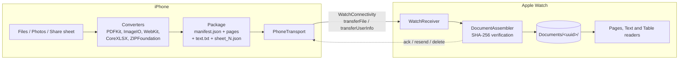

<p align="center">
  
</p>

<h1 align="center">WatchDocs</h1>

<p align="center">
  Send PDFs, photos, Word, Excel and text files from your iPhone to your Apple Watch,<br>
  then read them on your wrist, fully offline.
</p>

<p align="center">
  
  
  
  
  
</p>

---

## Why

The Apple Watch cannot open documents. Existing apps limit the number of pages or files you can send. WatchDocs has **no page limit and no document limit**: the only limit is the free storage of the watch.

Typical uses: a boarding pass or concert ticket with a QR code, presentation notes, a grocery list, a class schedule from Excel, a map for a run without your phone.

## Features

**iPhone app**
- Import from the Files app (multiple selection) and from the photo library.
- "Send to Watch" action in the iOS share sheet (Files, Photos, Mail, Safari, Messages).
- On-device conversion, since watchOS has no PDFKit, QuickLook or WebKit:

| Source | Pages mode | Text / Table mode |
|---|---|---|
| PDF (password protected too) | Rasterized pages (HEIC) | Extracted text |
| Images, photos | Resized image | |
| Word (`.docx`, `.doc`, `.rtf`) | WebKit layout printed to PDF | Text from the document XML |
| Excel (`.xlsx`, `.csv`) | Tables laid out as pages | One JSON table per sheet |
| Text (`.txt`, `.md`, `.json`, `.log`) | | Text with encoding detection |

- Preview before sending (editable title, page count, size, reading modes).
- Delivery tracking: *Converting, Waiting, Sending, Delivered, Failed*, with retry without reconverting.
- Settings: quality (500 / 800 / 1200 px), HEIC or JPEG, default reading mode, optional storage cap.

**Apple Watch app**
- Background reception, automatic queueing when the watch is out of reach.
- **Pages** reader: swipe between pages, Digital Crown zoom (1x to 4x), pan, double tap to reset, jump to any page.
- **Text** reader: four text sizes, Crown scrolling, Dynamic Type.
- **Table** reader: frozen header row, scrolling in both directions, sheet picker.
- Reading position saved per document, ticket mode (white background for QR codes), deletion synced with the iPhone.
- 100% offline. At most three decoded pages in memory, so a 1,000-page PDF opens instantly.

## Architecture



- **Three targets and one shared package**: iOS app, share extension, watchOS app, and `WatchDocsKit` (models, transfer protocol, storage).
- **Reliable transfer protocol**: a document is shown as ready only when every file listed in its manifest is present and its SHA-256 matches. Files arriving out of order, twice, corrupted or before their manifest are all handled. Stalled documents ask the iPhone to resend missing files.
- **Testable by design**: `WCSession` sits behind a `SessionLink` protocol. The whole protocol is tested with an in-memory link, and the shared package also builds and tests on Linux.
- **Ready for V2**: transport is abstracted behind `DocumentTransport`, so CloudKit sync can be added without touching the apps.

More detail, including the design decisions: [docs/ARCHITECTURE.md](docs/ARCHITECTURE.md).

## Tech stack

Swift 6 (strict concurrency in the shared package) · SwiftUI · Observation · SwiftData · WatchConnectivity · PDFKit · ImageIO · WebKit · CryptoKit · [CoreXLSX](https://github.com/CoreOffice/CoreXLSX) · [ZIPFoundation](https://github.com/weichsel/ZIPFoundation) · XcodeGen · Swift Testing · XCUITest · GitHub Actions

## Getting started

Requirements: a Mac with Xcode (iOS and watchOS platforms installed) and [XcodeGen](https://github.com/yonaskolb/XcodeGen).

```sh
git clone https://github.com/<your-username>/WatchDocs.git
cd WatchDocs
brew install xcodegen
cp Configs/Local.example.xcconfig Configs/Local.xcconfig   # set your team ID and bundle prefix
xcodegen generate
open WatchDocs.xcodeproj
```

The Xcode project is generated from [`project.yml`](project.yml) and is not committed. Full setup guide, including running on a real Apple Watch: [docs/INSTALL.md](docs/INSTALL.md).

## Tests

```sh
# Shared package: models, protocol, storage (also runs on Linux)
cd Packages/WatchDocsKit && swift test

# Converters and UI tests on the iOS simulator
xcodebuild test -scheme WatchDocs -destination 'platform=iOS Simulator,name=iPhone 16'
```

The protocol suite covers random arrival order, duplicates, corrupted and missing files, two-way deletion and a 1,500-page document. Transfers between paired simulators are unreliable, so device behavior is validated with a manual checklist: [docs/TESTING.md](docs/TESTING.md).

## Project structure

```
WatchDocs/
├── project.yml            XcodeGen spec (targets, packages, Info.plist)
├── Configs/               Signing settings (personal values stay local)
├── Packages/WatchDocsKit/ Shared Swift package and its tests
├── WatchDocs/             iOS app: import, conversion, sending, library, settings
├── WatchDocsShare/        Share extension
├── WatchDocsWatch/        watchOS app: reception and readers
├── Shared/                Code and strings shared by the app and the extension
├── Tests/                 Converter tests, UI tests and fixtures
└── docs/                  Architecture, requirements, install and testing guides
```

## Privacy

No server and no analytics: documents only travel between your iPhone and your watch. Files are stored with `completeUntilFirstUserAuthentication` protection. Photo access goes through `PhotosPicker`, so no full library permission is requested.

## Roadmap

- CloudKit sync so the watch can download documents without the iPhone nearby
- Folders and tags
- Watch complication for the last opened document
- Animated GIFs

## About

Personal project by **Chakib Selhi**, software engineering student at UQAM (Montréal). It started from a product requirements document ([docs/PRD.md](docs/PRD.md)) and was built with the help of Claude (Anthropic) as an AI pair programmer.

The UI is available in English and French.

## License

[MIT](LICENSE)
